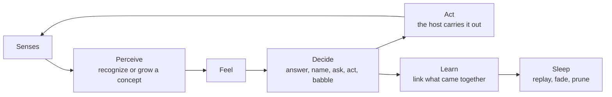

# Sourdough

**A starter for a baby AI.** It is born knowing no words, then grows by living with you: it sees, hears, talks, feels, decides and learns what its own actions do.

> "Instead of trying to produce a programme to simulate the adult mind, why not rather try to produce one which simulates the child's?"
> Alan Turing, 1950

Most AI starts as an adult. It reads a large part of the internet before anyone talks to it. Sourdough starts as a baby. No pretraining, no dataset, no training run. You show it things, name them, talk to it and tell it right or wrong, and it learns from that alone, the way a child does.

It is called Sourdough because it is a *starter*. It begins small, you feed it every day, it develops its own character, and you can give a copy to a friend so they can keep growing it.

Two films inspired it. From *Chappie*, a mind that grows up through care. From *Person of Interest*, The Machine, an observer that watches, decides and acts on its own.

## Quick start

```bash
git clone https://github.com/svviitzerland/sourdough
cd sourdough
python -m venv .venv && source .venv/bin/activate
pip install -e .
sourdough
```

A browser tab opens and asks you to name your first baby. The only dependencies are numpy and Pillow. Python 3.11 or newer works, and the repo pins 3.13 for [pyenv](https://github.com/pyenv/pyenv).

## Characters

Every Sourdough is a character of its own: a name, who it is in a sentence, and a color. You can raise as many as you like. Each one lives in its own folder and never shares what it learned with the others.

**Every baby is born a newborn, knowing nothing.** When you create one you may give it a starter pack, which runs the built-in lessons once, right then. After that it is simply that baby, and it only grows from what you teach it.

| Starter pack | It already knows | Try saying |
|---|---|---|
| none (newborn) | nothing at all | show it a picture and say what it is |
| Toddler | 10 colors, 8 shapes, everyday routines | "hello", "thank you", or show it a red star |
| Preschooler | also its own name and what animals say | "what is your name", "what does a cow say" |
| Kid | also colors of things, opposites, counting, kinds of things | "what color is the sky", "opposite of big", "after three" |

All of it works in English and Indonesian. It answers in the language you speak to it in.

```bash
sourdough                                   # open the web app with the baby used last
sourdough new kiki                          # create a newborn from the terminal
sourdough new bima --level kid --about "a clever kid who loves animals"
sourdough list                              # every baby and how far along it is
sourdough --name kiki                       # open the web app with kiki
```

## Using it

The left side is the baby's mind: every concept it has formed and every link between them, lighting up as it thinks. The right side has three tabs.

**Talk** is a conversation.

* Say something, or show it a picture or the camera and say what it is.
* After it answers, press **Right**, or **Wrong** and type the right answer. That one step corrects it and teaches it.
* When it babbles at something you said, press **Teach it what to say**.
* When it asks **?** about a picture, type what it is right under its question.

**Teach** has three simple forms, plus ready made lessons:

* **Name a picture**: choose a picture, type what it is.
* **An answer**: when I say ___, it answers ___.
* **An action**: when I say ___, it does ___.

**Diary** shows its life, moment by moment, and lets you put it to sleep.

Switch, create, edit or delete babies from the name at the top left. Deleted babies go to `~/.sourdough/trash`, so they can still be restored.

## It is curious

You do not have to speak first. When nothing happens for about half a minute it gets bored and does something by itself: it explores its own folder and asks about pictures it does not know, checks a word it is unsure of, or tries out its body. Answer it, and it learns.

## It acts, and learns from what happens

Sourdough is not given behaviors. It is given a body: a few actions whose effects it does not know. When it is bored it tries one, and whatever comes back is a new moment it learns from. Something new and surprising makes that action more likely next time. The same old thing makes it less likely. Curiosity is the reward, and your praise is a second one.

On the web, its body has two actions:

* **explore** opens a file from its own folder, `~/.sourdough/brains/<name>/world/`. A picture is seen, a text is heard. Drop your own pictures and texts there and it will find them. It can read nothing outside that folder.
* **glance** looks through the camera, when the camera is on.

A robot, a game or a smart home can give it a different body. See [docs/growing-it.md](docs/growing-it.md).

## Where its data lives

```
~/.sourdough/brains/<name>/
  profile.json      who it is: name, description, color, starter pack
  brain.json        what it knows: concepts, links, feelings
  journal.jsonl     what happened: one line per moment
  snapshots/        a copy of the brain after every sleep
  world/            its own folder of pictures and texts to explore
```

Everything is plain JSON. You can read it, diff it, keep it in git, or send it to a friend. Images and audio are never stored in the brain or the journal, only what the baby understood. Set `SOURDOUGH_HOME` to keep babies somewhere else.

## How it learns

One loop runs for as long as it lives:



Each step borrows from how real infants learn: concepts that grow from nothing (Adaptive Resonance Theory), word meaning from cross situational statistics, mutual exclusivity and the shape bias, attention to the end of a phrase, telling languages apart, dopamine style reward, curiosity as a reward for actions, and sleep consolidation. The full story, with references, is in [docs/how-it-learns.md](docs/how-it-learns.md).

## Use it from anywhere

The web page is one way in. The same brain works from Python, and over plain HTTP from any language or device.

```python
from sourdough import Nest
from sourdough.storage import babies

print([n.name for n in babies()])      # every baby you have

nest = Nest("kiki")                    # pick a baby by name
baby = nest.load()                     # or Nest("pip").create("toddler", about="...") for a new one
print(baby.observe(text="hello"))      # hi
baby.observe(text="look, a cat", image="cat.jpg")
print(baby.observe(image="another_cat.jpg"))   # cat
nest.save(baby)
```

```bash
curl -s localhost:8008/api/observe -d '{"text": "what does a dog say"}'
```

The full API is in [docs/architecture.md](docs/architecture.md).

## Honest limits

Sourdough will not out-talk a large language model. It knows what it was taught in your house, and it answers with single words and short phrases, not sentences. What it offers instead: it learns continuously while you use it, its knowledge is grounded in what it saw and heard, every concept and decision is readable, and it runs anywhere, offline. [docs/growing-it.md](docs/growing-it.md) maps where it can go next.

## Project layout

```
sourdough/
  brain.py         the life loop
  senses/          innate senses: words, vision, sound
  mind/            cortex (concepts), feelings, decisions
  memory/          associations, sequence, policy, journal
  body/            voice, actions
  foundation/      what it knows at birth: language roles, lessons, levels
  storage.py       where each baby lives on disk
  interface/       web server, the web body, the built web app
web/               the Svelte web app
docs/              how it learns, architecture, growing it
examples/          a terminal demo
tests/             behavioral tests, written like a baby's milestones
```

## Working on the web app

The web app is a separate Svelte project in `web/`. The Python package ships a built copy, so you only need Node to change it.

```bash
sourdough --no-browser      # the API on :8008
cd web && npm install && npm run dev
```

## Contributing

See [CONTRIBUTING.md](CONTRIBUTING.md) and [CLAUDE.md](CLAUDE.md). Commits follow [Conventional Commits](https://www.conventionalcommits.org).

## License

MIT
